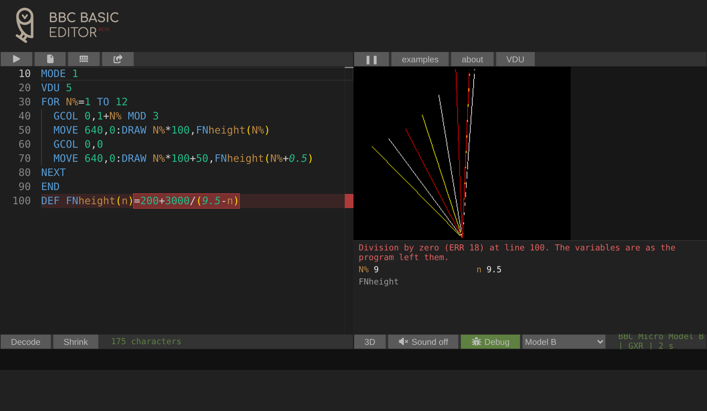
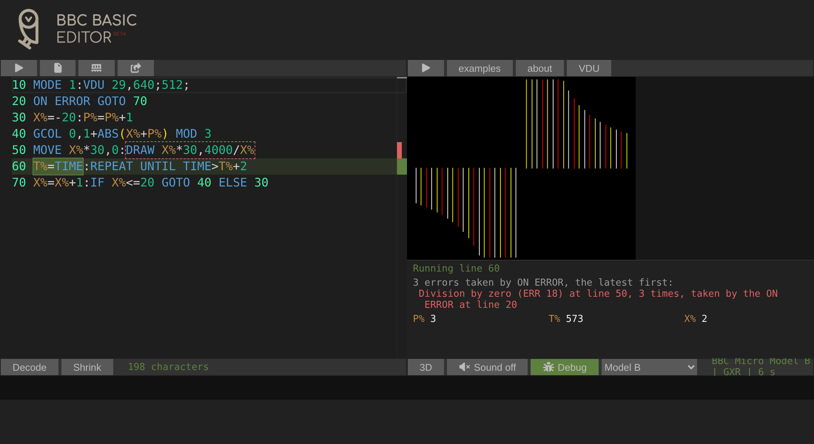

## Owlet Editor🦉 
A simple, intuitive creative coding tool for BBC BASIC inspired by [BBC Micro Bot](https://mastodon.me.uk/@bbcmicrobot)


Try the beta now at [bbcmic.ro](https://bbcmic.ro) and get coding!

## A modern editor for a classic language

* Fast, intuitive web-based editor (autocomplete, highlighting)
* Linked to 1000 BBC BASIC code examples from the [bbcmicrobot community](https://www.bbcmicrobot.com/)
* Based on Monaco editor

## BBC Micro emulator for instant feedback

* Integrated with JSbeeb emulator
* Sound, which starts off: use the Sound button under the emulator to turn it on
* A BBC Micro Model B (with the GXR graphics ROM, or without), or a BBC Master 128: choose with the menu under the emulator
* Share your entire program as a URL
* Export to external emulator for interactive use

### Links that ask for sound

Browsers only allow a page to make sound after a click or key press, so a link can't turn it on by itself.
Adding `?sound` to the address (for example `https://bbcmic.ro/?sound#...`) makes the Sound button flash, and the
first click or key press anywhere on the page turns sound on. Without it sound is off, so every existing link stays
quiet. The Share dialog adds `?sound` to the link it makes when sound was on. The setting isn't remembered between
visits.

### Machines

The menu under the emulator runs the program on a Model B or a Master 128 (BASIC IV, shadow screen modes such as
`MODE 128`, `PAGE` at `&E00`), and the editor checks the program against that machine's BASIC. The choice is kept with
the program in the browser, and a shared link records it: a link made for the Master has `"model":"Master"` in its
state, and a link without one, as every link made before there was a choice, runs on the Model B. The GXR ROM is only
fitted to the Model B, and "Model B" has it, as it always has; "Model B (no GXR)" leaves it out, for checking what a
program does on a Model B without the graphics extension. That choice is kept as `"gxr":false` in the state (and
as `B-no-GXR` in the browser), written only for it, so every other link is what it was; an older Owlet ignores the
field and runs the Model B with the GXR. The GXR is a fitting, not a different BASIC: the editor reads a Model B the
same either way. `?experimental` only shows the send to beebjit button, as it always has, and that button works on
either Model B.

### Debug: watching BASIC run

The Debug button under the emulator opens a panel under the screen with BASIC's variables (the resident integers
`@%` and `A%` to `Z%` that the program has written to, then every other variable, then the names of the procedures
and functions it has found), and marks the statement BASIC is running in the editor: its line faintly, the
statement itself more strongly, and the line in the scroll bar. Both follow the program as it runs, many times a
second, and stay where they were while the emulator is paused, so pausing shows where the program had got to.

What is shown is read from the emulated machine's memory, with jsbeeb's reading of BASIC's workspace, and works the
same on the Model B (BASIC II) and the Master 128 (BASIC IV). The statement is the one BASIC's text pointer is in: a
line `IF A=1 THEN B=2:C=3 ELSE D=4` has the statements `IF A=1 THEN`, `B=2`, `C=3`, `ELSE` and `D=4`, a `REPEAT`,
`DEF PROC` or `ON ERROR` is a statement apart from the one after it, and `REM` and `DATA` run to the end of the line.
An abbreviation such as `P.` is marked as it is written. The panel says:

- **Running line N**: the program is running (or paused in) line N, which is marked in the editor.
- **Waiting for keyboard input (GET) at line N**: the program is waiting in line N for a key, for `GET`, `GET$`, or
  `INKEY` or `INKEY$` with a time limit, or for a line to be typed for `INPUT` or `INPUT LINE`; the brackets say which
  (for `PRINT GET;GET$`, which of the two), and are left out where it is not one of those, as for machine code that
  calls OSRDCH. A key pressed (and Return, for `INPUT`) takes it back to running. A program that reads the keyboard
  without waiting, as `INKEY(0)` and `INKEY(-n)` do, is running.
- **Waiting for vsync at line N**: the program is in `*FX19`, which waits for the next vertical sync, at most a
  fiftieth of a second. This is shown whenever the emulator's frame ends in the wait, so a program that waits for vsync
  shows it in turn with running, about as often as it waits.
- **Waiting for room in the sound queue at line N**: a `SOUND` whose channel already has its queue of notes waits for
  one to finish.
- **Waiting for the filing system at line N**: a `CHAIN`, `OPENIN`, `*CAT` or the like is waiting for the disc
  filing system. Owlet has no disc in the drive, so these wait for ever: Escape stops them on the Master 128,
  BREAK on either.
- **Running line N, which is not as in the editor**: the editor's line N is not what BASIC has, as after an edit
  since the program ran. Nothing is marked until the program runs again; the variables still update. Lines that were
  not edited are still marked, so an edit to one line does not lose the others.
- **No such variable (ERR 26) at line N**: the program stopped with that error in line N, which is marked in red:
  the statement the error was in, or the whole line where that is not known (see below). The variables are as the
  program left them, as they are on a real BBC Micro. This stays, through anything typed at the prompt, until the
  program runs again (from the run button, or a `RUN`, `GOTO` or `PROC` typed at the prompt; not a `LIST`), which is
  the point: the message is often not on the emulated screen, after `VDU 5` with the graphics cursor off the screen
  or in the background colour, or a `CLS`, or once a mistyped `REPORT` has replaced it.
- **STOP at line N** is shown the same way: the program stopped where it should not have gone on.
- **Escape (ERR 17) at line N** is shown the same way but in amber, as people press Escape on purpose.
- **..., which has changed since the error**: the editor's line N is not what BASIC ran, so nothing is marked.
- **Mistake (ERR 4) in a command typed at the prompt**: an error in a command typed at BASIC's prompt, shown only
  until the next command, and never in place of the error the program stopped with. BASIC gives such an error line
  0, as it does an error in a line numbered 0, so Debug tells them apart by whether a statement of the program had
  started since the last command was typed; switched on after the error, it takes line 0 to be the prompt.
- **At BASIC's prompt**: the program has ended, without an error, or not started; its variables stay as it left them.
- **Not BASIC**: another language ROM has taken over.

Under the status, the panel lists the errors that `ON ERROR` handlers took in this run, which are otherwise easy to
miss: once a handler runs, BASIC's own state no longer shows the error, and the handler may print nothing, or clear
the screen. The latest is first, each as `No such variable (ERR 26) at line 140, 3 times, taken by the ON ERROR at
line 20`, under the number taken in all. The last eight different errors are kept (an error is the same if it has the
same number, message, line, statement and handler, statements being told apart at colons, `THEN`, `ELSE`, `REPEAT`,
`IF` and the end of a `DEF`'s name and parameters, though not at an implicit `THEN` before anything but an `IF`, as in
`IF X Y=1`); a handler that loops on its own error, thousands of times a second, is one row with a growing count. The
latest one's statement is marked in the editor with a dashed box, which fades after about a second of the program
running on without another; the error the program stopped with, if it did, keeps its solid red mark and the status line,
and is not counted among the handled ones. Escape taken by a handler is listed in amber. The list starts afresh when the
program runs again, as the error the program stopped with does. The line is the one `ERL` gives, but found from BASIC's
text pointer as the error is raised, so an error in a line numbered 0 is at line 0, and one in a command typed at the
prompt has no line.

An error numbered 0 (`STOP`) never goes to an `ON ERROR` handler, so it is never listed: BASIC's own handler takes it.
Only plain `ON ERROR` exists in BASIC II and BASIC IV; `ON ERROR LOCAL` is BASIC V's, and on these machines sets a
handler that runs `LOCAL`, which fails with `Not LOCAL` and so loops forever, as the list then shows. Handled errors
are caught as they are raised, so only those raised while Debug is on are listed.

A program is waiting when BASIC has not moved on to another statement for a whole frame of the emulator (a sixtieth of
a second or so) and the machine is in the OS's routine that reads the keyboard, in the filing system's ROM, or in a
`SOUND` statement; and in any frame that ends in `*FX19`'s wait, which is never longer than a frame. jsbeeb works out
which of these the machine is in. Anything else that holds a program up, such as a long `PRINT`, or machine code that
waits in a loop of its own, is shown as running. The waiting line and statement are marked as the running ones are, and
`..., which is not as in the editor` is added in the same way.

A program has stopped with an error when BASIC's own error handler, which is BASIC text in its ROM, is the last text it read; the
number and message are those `ERR` and `REPORT` give, and the line is `ERL`. BASIC keeps no note of where in the line
the error was: its error handler moves its text pointer to the `ON ERROR` text. So the statement is known only when
Debug was on as the error was raised, and caught the pointer then; switched on later, Debug marks the whole line. An
error inside an `EVAL` marks the statement the `EVAL` is in, as `X=EVAL("x")` in `IF 1 THEN X=EVAL("x")`. BASIC raises
an error in a `PROC`'s or `FN`'s arguments, inside an `EVAL` or not, at its `DEF`, so that is what is marked: the `DEF`'s
name and parameters, in the line `ERL` gives.

A resident integer is shown once the program has written to it, even if it wrote the value BASIC starts it with, so
after `X%=1:X%=0` the panel shows `X%` as `0`. Running the program again starts afresh, with nothing written. Debug
notes the writes from the moment it is switched on, so what the program wrote earlier is not known: for those, a
resident integer is shown only if it is not as BASIC starts it (`@%` other than `&90A`, `A%` to `Z%` other than 0).
Switch Debug on before running the program (the run button runs it again) to see them all.







While Debug is off nothing is read from the machine and nothing is hooked, so it costs nothing. While it is on, the
emulator notes writes to the resident integers, where BASIC was and which handler was set when the OS takes an error,
and when a statement of the program starts or BASIC moves on, through jsbeeb's write hook, which makes it do a little more work on each write the program makes. Debug is not remembered between visits.

## Share your creations with the BBC Micro Bot Mastodon community

* One button tweet to share code (not yet updated for Mastodon)
* Automatic code golfing tools - byte token encode/decode


## To develop

```
$ make run   # Starts the Vite development server
$ npm run build   # Build for production
$ npm run preview   # Preview the production build locally
$ npm run e2e   # Build, then drive the built page in a browser (first: npx playwright install chromium)
```

Then visit http://localhost:8080

## Build System

Owlet Editor uses Vite as its build system. The project was migrated from webpack to Vite to align with the jsbeeb dependency, which also uses Vite.

## Highlighting: what red means

Red means that BBC BASIC II would stop with an error at that statement if it ran it, and that no more typing at the end
of the line could change that. On a Master 128 it is BASIC IV that is meant ([below](#basic-iv-the-master)), and the
rest of this section holds for either. The colours are a function of the text alone, wherever the cursor is.

- **Red runs to the end of the statement**: BASIC stops at the first token that cannot continue a
  statement and never reads the rest of it, so that token and everything after it up to the end of the statement is red.
  `I am a badger` is `I` as a variable and `am a badger` red; `GOTO 20 30:PRINT 5`
  is red on `30` only, since the statement ends at the colon and `PRINT 5` is judged on its own. A statement ends at a
  colon or an `ELSE` outside a string, or at the end of the line, and in an assembler block also at the `]` that closes
  it. A `REM` or `DATA` after the stop point, its comment or items, and a `*` command are not code and keep their own
  colours. Red text never takes part in bracket matching. A line that is only unfinished is not red at all.

- **Never red on code the ROM accepts.** The number of false-invalids (the ROM runs a statement, the editor shows it
  red) must be 0 on the recorded tables, the ROM oracle and the saved programs.
- **Text that is not code is never red:** a comment after `REM`, the items after `DATA`, a `*` command, and the rest
  of a line after an `ELSE` that starts a statement or a `DEF` that is not `DEF FN` or `DEF PROC`, and an `ON ... GOTO`
  list after its first target, all of which BASIC skips.
- **Unfinished is not red**: a line that BASIC rejects only because something is still to be typed keeps
  its ordinary colours, so a line can be typed a key at a time. Something is still to be typed where the line ends:
  `G`, `GOTO`, `GOTO `, `FOR I=1 TO`, `PRINT (1+`, `PRINT "HI` (a string with no closing quote yet) and `[LDA` are
  unfinished, including a name or keyword that could grow into a longer keyword (`FOR I=1 T`, `X=1 AN`, `ENDP`, `MOD`
  for `MODE`, `A=TO` for `TOP`) or a mnemonic (`[LD`). One more shape is unfinished: a statement that stops at a `)`
  when something typed just before it would make the statement valid (a missing operand, argument or trailing `,`). That is what an editor that closes brackets shows while a call is typed:
  `A$=LEFT$()`, `A$=LEFT$(B)`, `A$=LEFT$(B$,)`, `PRINT (1+)`, `PRINT TAB(1,)` and `DIM a()`. Monaco closes only `(` and `"`, and
  an open `"` is unfinished already. The recogniser tries a short list of fillers (a value, `,1`, `1,1`...) at the `)` and asks whether the statement is then valid. `A$=LEFT$(X$)` is also
  unfinished, though it is one argument short as written, because it is what the editor shows at `LEFT$(X$|)` and
  cannot be told apart from the finished text. The colour cannot know the cursor, so a line that stays like that in a
  finished program is shown by a marker instead, below. Everything else that stops short is red, with no allowance
  for text typed in front of what is already there: no typing at the end of the text mends it, and the ROM rejects it
  as written. `GOTO:PRINT`, `FOR I=1 TO:NEXT`, `IF PRINT 2` and `X=1+:PRINT X` are red, and so are `GOTO 20 30`, `PRINT )`,
  `A=1'`, `X=1+*` and `PRINT (1+2))`. A line typed in front of existing text is therefore red at the keys where the
  statement is not yet finished (`FOR I=1 TO 10` in front of `:PRINT I:NEXT` is red from `F` to `FOR I=1 TO `, and not
  red once the `10` is there). Words typed straight against the word after them with no space (`IF A=1 TPRINT 2`,
  which is a name, `TPRINT`, and a number) are red until the space is typed.
- **Markers**: about half a second after the last edit (the old markers stay, and move with the text,
  until then), a statement BASIC would stop at gets an error squiggle on its red text, and a line that is unfinished gets a warning
  squiggle: at its end, or at the token where the statement stopped when something is missing from the middle. Both
  come from the recogniser that colours the text. The message is the ROM's own error text (`Mistake`, `Syntax error`,
  `No TO`, `Missing ,`, `Missing "` and so on) where the recogniser knows it; the recorded rows in
  `test/rom/verdicts` are checked against it, and where a site is worded differently by context (a call's
  arguments) there is no text rather than a guess. Markers may depend on the cursor, unlike the colours: the line the
  cursor is on is not marked as unfinished (it would blink with every key), and is marked as soon as the cursor
  leaves it. An assembler block that is never closed is one error on its `[` in place of one per later line (the
  later lines are coloured as before). A syntax marker is left out where a warning already covers the same text
  (`x == 3` has the warning about `==`), and quick fixes are offered only for the warnings, never for a syntax marker,
  apart from an index register that BASIC II reads only in capitals (`LDA 42,x`, `STA (42),y`): its fix, "Replace x
  with X", is offered only where the statement in capitals has no error and does not end too soon (not for
  `ASL 42,y`, as `ASL` takes only `X`, nor for `LDA (42,x`, which is still missing its `)`). The same goes for `ORa` on BASIC II, which reads the `A` of
  `ORA` only in capitals: "Replace ORa with ORA", offered on the same condition. An instruction that only BASIC IV's
  assembler has (`BRA`, `CLR`, `DEA`, `INA`, `PHX`, `PHY`, `PLX`, `PLY`, `STZ`, `TRB` and `TSB`, found by trying every
  three-letter word on both ROMs) is said to be a BASIC IV instruction when BASIC II stops at it, naming just the
  mnemonic. Suggested by Olly Betts on #291 and #311.
- **Line number markers**: after the same delay, an error squiggle on a `GOTO`, `GOSUB`, `THEN`,
  `ELSE` (and so `ON ... GOTO` lists) or `RESTORE` that names a line the program does not have (BASIC's `No such line`),
  and on any line number above 32767, which BASIC cannot have: the program ends at the first such line, so BASIC never
  runs it. That includes a line without a number that the editor would number above 32767, which takes a program of
  over 3276 lines. A `GOTO`, `GOSUB`, `RESTORE` or `TRACE` number of 65536 or more is marked too: the ROM keeps only its
  bottom 16 bits (`TRACE 65536` is `TRACE 0`) and says `Too big` from 2147483648. `THEN` and `ELSE` say `Syntax error`
  above 32767. `LIST`, `DELETE`, `AUTO` and `RENUMBER` are not marked, and a `TRACE` is not marked as missing, as
  their numbers need not be lines. A reference on the line the cursor is on is not marked as missing until the cursor
  leaves it.
- **Line numbers follow the edits of a program without them**: the editor numbers such a program 10, 20, 30... and
  rewrites each `GOTO`, `GOSUB`, `THEN`, `ELSE` and `RESTORE` as lines are added and removed. A `TRACE` limit that is
  not a line keeps its place between the same two lines (the number just above the one below it). A reference to a
  line that does not exist is otherwise left as it is, so placeholders such as `GOTO 11` do not collapse together.
- **Code is red if it would stop BASIC when run, even where it cannot run** (on purpose):
  - the branch of an `IF` whose condition is false, which BASIC skips;
  - the body of a `DEF FN` or `DEF PROC`, which BASIC skips on its way through the program and runs only when called;
  - statements after `GOTO`, `END`, `ENDPROC`, `RETURN`, `STOP` or a function's `=` on the same line, which can
    never run. Acorn's Welcome disc has one: `IF CHAR=2 THEN=45:FORCE -` (line 7310 of `W.KEYBD`) is red, and its
    `FORCE -` can never run.
- **False-valids are measured, not gated.** Where the ROM rejects a statement and nothing is red, that is reported by
  the oracle, but it is never a reason to fail a change.
- **The oracle reads only the stop token as evidence.** The red after it is text BASIC never read, so the oracle
  asks the ROM about each red run in turn and drops the ones it never reads, as it does for any text BASIC skips; a
  statement's verdict is as before.
- **Unfinished is a third answer in the oracle.** A statement the ROM rejects and the recogniser calls unfinished is
  neither a false-valid nor a false-invalid; the oracle counts it as agreement and lists it apart, and also lists
  any such statement that the ROM accepts (there must be none), outside the text BASIC skips. Where a statement is
  unfinished at a `)`, some insertion there should make the ROM accept it; the oracle does not check that, so
  check it by hand with the ROM when the fillers in `src/parser/recogniser.js` change.
- **Stricter than the ROM only on purpose.** The exceptions are the list below; each is a row of the recorded table
  listed as stricter than the ROM in its test, and the oracle reports them as STRICTER, apart from the false-invalids.
  The one place it is more lenient is `COLOR` on a Model B ([below](#the-other-way-lenient-on-purpose)), which the
  oracle reports as LENIENT.

### Characters above U+007F

BASIC keeps only the low eight bits of each character the bot or the emulator's tokeniser gives it, so a character is
the byte it ends in: U+00A2 and U+01A2 are both `&A2`, U+0141 is `A` and U+0122 is a quote. The highlighter reads each
line that way (`byteView` in `src/parser/lexer.js`), so programs that spell a token byte differently still highlight
as they run. Offsets do not change, since the view is the same length, and a control byte (U+0100 to U+011F) is left
alone because U+010A is data and not a line break. Shrink writes each token byte as one visible character: the byte
itself, or the one 0x100 above it for the control bytes, `&7F` to `&9F`, and `&A0` and `&AD`, which would otherwise be
a non-breaking space and a soft hyphen.

### Deliberate deviations from the ROM

Text the ROM runs without error that is red on purpose, because it is almost always a mistake. Each has a hover
message that says what BASIC does, and shows as an error.

- **Anything but a comment after a complete assembler instruction** (`NOP PRINT`, `LDA #1 hello`, `NOP 5`,
  `LDA #1 ,X`, `LDA #1]`). BASIC ignores the rest of the statement up to the next `:`; the first thing there that is
  not a `\` comment is red (just that token), probably a comment missing its `\`. That includes `;`, which BASIC II
  ignores like any other junk (later BASICs, such as the ARM assembler in BASIC V, take it as a comment). A `]` there is
  the commonest case. It does not close the block: BASIC ignores it like the rest and goes on assembling, so after
  `[LDA #1]` the next line `tax=1` is assembled as `TAX` followed by ignored junk, not run as an assignment
  (`[OPT0:NOP]:tax=1` assembles `EA AA`). A `]` after the colon closes it (`[OPT0:NOP]:]:P%=P%+5` runs the
  assignment), as `[LDA #1:]` does. The hover for a `]` says that a `:` is probably missing before it. Flagging the junk
  and the two quick fixes, "Insert : before ]" for a `]` and "Insert \ before the junk" for the rest, were suggested by
  Olly Betts on #174. The oracle takes these marks on trust as ignored text (cutting the statement there changes
  nothing, so it cannot test them) and lists them as STRICTER.
  - **A keyword straight after a mnemonic** (`STAH.,X`, `LDAUSR@%+GET`). BASIC tokenises a keyword only at the start of
    a word, so `STAH.` is the word `STAH`: `STA`, then the variable `H` (an undefined one reads as `P%` unless `OPT` has
    bit 1 set, when it is "No such variable"), and `.,X` is ignored; the same text with a space, `STA H.,X`, is
    `STA HIMEM,X`. Where a space would leave nothing red, the junk is red as before but the hover says that, and the
    fix is "Insert a space after STA" instead of the generic junk fix. A mnemonic that takes no operand
    (`NOPPAGE`) keeps the `\` fix. `STAPAGE` and `LDAGET` have no junk after the variable, so they are not red.
    Suggested by Olly Betts on #174.
- **A character in a mnemonic that is not a letter** (`LD89`, `ST89`, `CP8 5`, `SEC` spelt `3EC`). BASIC compares only
  the low five bits of each character, so it reads `8` as `X`, `9` as `Y`, `!` as `A` and so on: `LD89` is `LDX 9`, but
  is an easy typo for `LDA89`, `LDX89` or `LDY89`. Olly Betts suggested on #174 marking this, and marking the `LD` (in
  `LD89`, `ST!76`, `CP8 5`) rather than the character, since `LD` on its own is not an instruction and the register
  letter was probably left out; the hover says what BASIC reads the character as and which letters were probably
  meant. Where the character is not the third (`J-P`, `3EC`, `O2A`), no prefix is to blame, so just that character
  is red. Upper and lower case letters stay valid, and so does `LDA89` (`LDA` and the number 89). A control character
  (below 32) is read by its low five bits too, so U+0101 (byte 1) is an `A`. A byte of 0x80 or above is not: the ROM
  rejects it in a mnemonic (`ST` and byte 0x81), except the tokens AND (0x80), EOR (0x82) and OR (0x84) as the first,
  second or third character, which it reads as the mnemonic itself, dropping what comes before (`ST` and byte 0x80
  assembles `AND`). The dropped characters are red, with a hover that says so (recorded for #202).
- **An `ELSE` that no `IF` is waiting for** (`X%=6ELSE7`, `PRINT 1 ELSE PRINT 2`, and the second `ELSE` of
  `IF0ELSEPRINT"X"ELSEPRINT"Y"`). BASIC skips the rest of the line at any `ELSE` it runs into, which is right at the end
  of the `THEN` part of an `IF` (or after an `ON` list) and a quirk anywhere else. The `ELSE` is red and the text after
  it is not, since BASIC does not read it. BASIC does not nest `IF`: it scans forward for the first `ELSE`, so an `IF`
  or `ON` waits for one `ELSE` and the first it meets is its own. `IF A THEN IF B THEN x ELSE y ELSE z` has its second
  `ELSE` marked, as `IF0ELSEELSEPRINT"x"` does, but an `IF` or `ON` after an `ELSE` waits for another, so
  `IF A THEN x ELSE IF B THEN y ELSE z` is not marked. Suggested by Olly Betts on #319.
- **A string where BASIC wants a number, or the other way round** (`PRINT"X"DIV 2`, `X=1+"A"`, `X$="A"+1`, `X=LEN 5`,
  `PRINT STR$A$`). BASIC raises "Type mismatch" when it runs such a statement, not when it reads it, so a program that
  never gets there is fine. The operator or function word is red, with a hover that says what is wrong. It is marked for
  a binary operator (`- * / ^ MOD DIV AND OR EOR`) with a string on either side, for `+` and a comparison between a
  string and a number, and for a function given the wrong kind (`ASC`, `LEN`, `VAL`, `OPENIN`, `OPENOUT` and `OPENUP`
  take a string; the other functions and `STR$` and `CHR$` take a number; `EVAL` takes either). A value is a string
  if it is a string, a name ending in `$`, a function ending in `$`, `$X` or a bracket round one; a number if it is a
  number, any other name, any other function or an operator's result. Anything else, such as a `FN`, `TIME` (`TIME$` on
  the Master) or what follows a `?` or `!`, is not known and is never marked, nor are the arguments of `LEFT$(`, `MID$(`,
  `INSTR(` and the like, assignments, or a condition that is itself the wrong type (`IF "A" THEN`). The oracle cannot test these marks: a statement that stops with
  Type mismatch is inconclusive, and in one that does not run (`IF 0 THEN`) the mark is in text BASIC never reads. The
  rows recorded for #331 are the other half, strings that BASIC runs without complaint (`PRINT"X"D`, `X$="A"+"B"`,
  `X=ASC GET$`), which must stay unmarked. Suggested by Olly Betts on #323; because completions drop a word that makes
  the statement red, `PRINT"X"D` no longer offers `DIV`, `AND`, `OR`, `EOR` or `MOD`. While a line is typed in the editor
  `LEN(B` is red until the `$` is typed.

#### The other way: lenient on purpose

One deviation goes the other way, accepting what a Model B's ROM rejects (and so is not red, and has no marker).
Olly Betts suggested it on #245: a program written for the Master with the US spelling `COLOR`, or run on a Model B
after being written on one, should still work.

- **`COLOR` is `COLOUR` on a Model B where that is all it can be.** BASIC II has no `COLOR` (`COLOR 7` is the variable
  `COLOR` and then a Mistake), and BASIC IV makes it the `COLOUR` token (`&FB`) wherever it is. On a Model B, Owlet reads a
  `COLOR` as `COLOUR` only when it starts a statement (after a colon, `THEN`, `ELSE`, `REPEAT`, `ON ERROR` or at the start
  of the line), what follows is one expression and then the end of the statement (the end of the line, a colon or
  `ELSE`), and the statement is not already valid as it is written. Anywhere else it stays the characters of a name.
  - Taken: `COLOR7`, `COLOR X`, `COLOR(1)`, `IFC%COLORC%ELSECOLORD%:NEXT`, `X=1:REP.COLORX:P.;X:X=X+1:U.X>7`,
    `ONERRORCOLOR7:GOTO1000`, and in `LETCOLOR=3:COLORCOLOR` only the second `COLOR`, which is a variable as the operand.
  - Not taken: `COLORS=7`, `COLOR=7`, `COLOR(1)=7` and `COLOR?1=7` (assignments, valid as written), `LETCOLOR=3`,
    `PRINT COLOR`, `X=COLOR` (not the start of a statement), `COLOR 1,2` and `COLOR 7 7` (not one expression, which
    BASIC II rejects as ever), `color 7` (keywords are upper case, on the Master too), and anything in a string, `REM`,
    `DATA` or `*` command, or on a line of an assembler block that an earlier line opened (the ROM tokenises each line on its
    own, and in a block `COLOR` is assembled text, so the tokeniser carries the block from line to line as the highlighter does).
    A `COLOR` alone at the end of the line is a variable still being typed and is not red.
    `COLORS` alone is read as `COLOUR S`, since that is a whole statement, and goes back to a variable at `COLORS=`.
  - The same reading makes the Model B's tokeniser write `&FB` for it, so the program that runs is the program that
    is shown. The Master is unchanged: there `COLOR` is a keyword everywhere, as its ROM has it.
  - The recorded rows for BASIC II are still the ROM's answer, and are checked against `BasicIIDialect`; the editor's
    Model B is `ModelBDialect`, BASIC II plus this, and the rows it is lenient on are `LenientThanRom` in
    `test/rom-tables.js`, which must have no mark. The oracle lists them apart as LENIENT, not as false-valids, wherever
    a `COLOR` was read as `COLOUR`.

### BASIC IV (the Master)

With the Master chosen the parser follows BASIC IV, which differs from BASIC II in these ways (`src/parser/dialect.js`
holds the setting, which the lexer, recogniser and assembler read as each line is made; highlighting, markers, warnings
and completions all follow it, and a change of machine colours the text again). Each was checked by running the
statement on the Master's ROM in jsbeeb, and the rows are in `test/rom/verdicts-master` and
`test/rom/tokens-master`; the tests check each row against the rules of its own machine.

- **Keywords:** `COLOR` is `COLOUR` (the same token) and `EDIT` is a command (token `&CE`, which BASIC II does not have).
  The tokeniser is otherwise BASIC II's, which `lexfuzz.mjs --master` checks, apart from dropping the spaces at the end
  of a line as it stores it.
  It is a command only to the prompt: wherever a program starts a statement with it (`EDITED=FALSE` reads as `EDIT`
  then `ED=FALSE`, and `ED.` and `EDIT 10` are the same), BASIC stops with `Syntax error`, so that is red; in an
  expression (`PRINT EDIT`) it is a missing variable, as for any keyword.
- **`VDU`:** a `|` ends an item as `,` and `;` do, and sends nine zeros, so `VDU 23,255,255|` is valid. A `|` straight
  after `VDU`, `,`, `;` or another `|` is still an error, as is a `,` or `;` after one, and a `|` anywhere else.
- **`EXT#`** is a statement (`EXT#X=0`), read as `PTR#` is; `EXT` without the `#` says `Missing #`.
- **`TIME$`**, with the `$` straight after `TIME`, is a string value and can be assigned to (`TIME$="..."`).
- **`ON ... PROC`:** the list can name procedures as well as lines.
- **Assembler:** the 65C12's `BRA`, `PHX`, `PHY`, `PLX`, `PLY`, `INA`, `DEA`, `STZ` (zero page or absolute, with `,X`),
  `TRB` and `TSB` (no index); `BIT` takes `#` and `,X`; `INC A` and `DEC A`; `(&70)` as a zero page address for
  `ADC AND CMP EOR LDA ORA SBC STA` (BASIC ignores what follows the `)` unless it is a comma, which must be `Y`), and
  `JMP (&1234,X)`. The index register, the `a` of an accumulator operand, the `a` of `ORa` and the size of an `EQU`
  are read in either case. `ST:` reads as `STZ`, as the third character of a mnemonic is compared in its low five bits
  (the aliasing rule above), so it needs an operand. `RMB`, `SMB`, `BBR`, `BBS`, `WAI` and `STP` are not there.
- **Errors:** `Bad Hex` for BASIC IV's `Bad HEX`. `ERROR 5,"x"` is a syntax error, as on BASIC II.

Not covered: `LIST IF`, and BASIC IV's own message wording beyond `Bad Hex`. `node
tools/rom-oracle/oracle.mjs --master` runs the oracle on the Master with extra statements for BASIC IV
(`generate-iv.mjs`); `record.mjs --master` and `lexfuzz.mjs --master` do the same for the tables and the tokeniser.

The highlighter is the tokenizer in `src/parser`: a port of the ROM's tokeniser, a recogniser that marks the token at
which BASIC would stop with an error and the rest of that statement, and the assembler. Bracket colouring and matching
work as for any Monaco language (an unclosed `(` is not red while its line is unfinished).

Expected values come from the ROM, not from beliefs about it. `node tools/rom-oracle/record.mjs 'X=Y.5'` runs a
statement on BBC BASIC II and records its verdict (the error's name or `ok`) in `test/rom/verdicts`, and
`--tokens` records the ROM's tokenisation of a line in `test/rom/tokens`; nobody types a verdict. A byte of 0x80
or above cannot go through the shell, so `--hex '53 54 8d 20 39'` takes the statement as hex bytes (also for each
`--file` line); the row's text is those bytes as Owlet shows them, U+0100 plus the byte below 0xA0.
`--source '#149'` ends each row with the issue it comes from, so that a report seen before is one search of the tables
away, and keeps the row in that table's `149.json` (rows without a source go in `unsourced.json`): each table is a
directory with a file per source, so pull requests that record rows do not conflict. Always give `--source`, and do
not edit the files by hand; a test fails if a row is in the wrong file. Before a change to
highlighting, `node tools/rom-oracle/oracle.mjs` compares the highlighter with the ROM on generated statements (see the comment at its top).

## Known Issues

- In assembler, anything but a `\` comment after a complete instruction is red on purpose; see "Deliberate deviations" above.
- When running tests, you may see warnings about missing source maps for Monaco Editor. This is a [known issue with Monaco Editor 0.52.0+](https://github.com/microsoft/monaco-editor/issues/4712) and doesn't affect functionality.
