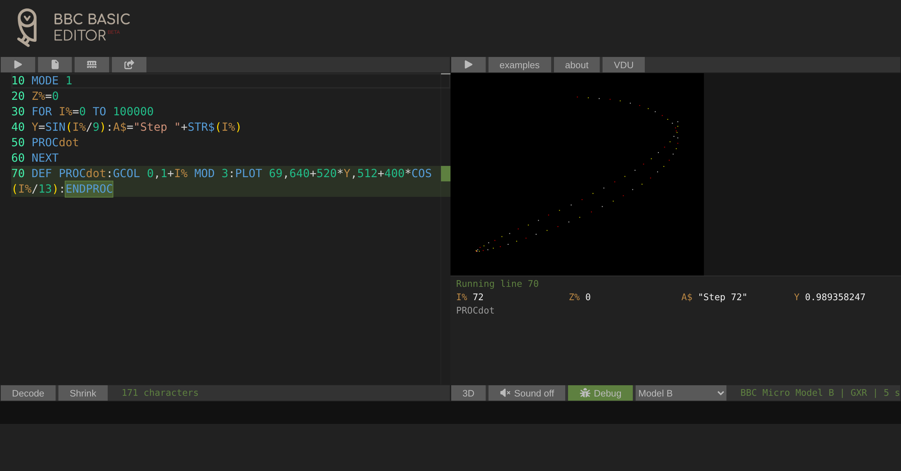

## Owlet Editor🦉 
A simple, intuitive creative coding tool for BBC BASIC inspired by [BBC Micro Bot](https://mastodon.me.uk/@bbcmicrobot)


Try the beta now at [bbcmic.ro](https://bbcmic.ro) and get coding! Type a program in the editor, press the run button,
and it runs on an emulated BBC Micro beside it.

## A modern editor for a classic language

* Fast, intuitive web-based editor (autocomplete, highlighting)
* Linked to 1000 BBC BASIC code examples from the [bbcmicrobot community](https://www.bbcmicrobot.com/)
* Based on Monaco editor

## BBC Micro emulator for instant feedback

* Integrated with JSbeeb emulator
* Sound, which starts off: use the Sound button under the emulator to turn it on
* A BBC Micro Model B (with the GXR graphics ROM, or without), or a BBC Master 128: choose with the menu under the emulator
* Share your entire program as a URL
* Export to external emulator for interactive use

### Links that ask for sound

Browsers only allow a page to make sound after a click or key press, so a link can't turn it on by itself.
Adding `?sound` to the address (for example `https://bbcmic.ro/?sound#...`) makes the Sound button flash, and the
first click or key press anywhere on the page turns sound on. Without it sound is off, so every existing link stays
quiet. The Share dialog adds `?sound` to the link it makes when sound was on. The setting isn't remembered between
visits.

### Machines

The menu under the emulator runs the program on a Model B or a Master 128 (BASIC IV, shadow screen modes such as
`MODE 128`, `PAGE` at `&E00`), and the editor checks the program against that machine's BASIC (see
[BASIC IV on the Master](docs/highlighting.md#basic-iv-the-master)). The choice is kept with the program in the
browser, and a shared link records it; a link made before there was a choice runs on the Model B. The GXR ROM is only
fitted to the Model B, and "Model B" has it, as it always has; "Model B (no GXR)" leaves it out, for checking what a
program does on a Model B without the graphics extension. The GXR is a fitting, not a different BASIC: the editor reads
a Model B the same either way. `?experimental` only shows the send to beebjit button, as it always has, and that button
works on either Model B.

### Debug: watching BASIC run

The Debug button under the emulator opens a panel under the screen with BASIC's variables (the resident integers `@%`
and `A%` to `Z%` that the program has written to, then every other variable, then the procedures and functions it has
found), and marks the statement BASIC is running in the editor: its line faintly, the statement itself more strongly,
and the line in the scroll bar. Both follow the program as it runs, and stay where they were while the emulator is
paused, so pausing shows where the program had got to. It works on the Model B and the Master 128 alike.

The panel says what the program is doing: running line N; waiting at line N for a key (`GET`, `INPUT` and the like),
for vsync (`*FX19`), for room in the sound queue, or for the filing system (Owlet has no disc in the drive, so that
waits for ever); or stopped with an error, such as **No such variable (ERR 26) at line N**, with the statement marked in
red. That stays until the program runs again, which helps when the message isn't on the emulated screen, after
`VDU 5` or a `CLS`. Escape is shown in amber, as people press Escape on purpose. Under that, the panel lists the errors
that `ON ERROR` handlers took, which are otherwise easy to miss, and marks the latest one's statement with a dashed box.

Switch Debug on before running the program (the run button runs it again): what happened before it was on is not
known. While Debug is off it costs nothing.




Every status, how handled errors are counted, and how Debug works it all out are in
[docs/debugger.md](docs/debugger.md).

## Share your creations with the BBC Micro Bot Mastodon community

* One button tweet to share code (not yet updated for Mastodon)
* Automatic code golfing tools - byte token encode/decode

## Highlighting: what red means

Red means that the real BBC BASIC, the one in the machine's ROM (BASIC II on a Model B, BASIC IV on a Master 128),
would stop with an error at that point if it ran the line, and that no more typing at the end of the line could change
that. BASIC stops at the first
thing that cannot continue a statement and never reads the rest of it, so the red runs from there to the end of the
statement (a colon, an `ELSE`, or the end of the line): `I am a badger` is `I` as a variable and `am a badger` red, and
in `GOTO 20 30:PRINT 5` only the `30` is red.

- **A line you are still typing is not red.** `FOR I=1 TO`, `PRINT "HI` and `A$=LEFT$()` (the editor closes the
  bracket for you) keep their ordinary colours, so a line can be typed a key at a time. A line left unfinished gets a
  warning squiggle once the cursor moves off it.
- **Hover over red text for the reason.** About half a second after you stop typing, red text gets an error squiggle,
  with BASIC's own message where Owlet knows it (`Mistake`, `Syntax error`, `No TO`, `Missing ,`...). F8 goes to the
  next one.
- **The lightbulb offers a fix** where there is an obvious one (Alt+Enter does the same), such as "Insert : before ]"
  or "Replace x with X".
- **Line numbers are checked**: a `GOTO`, `GOSUB`, `THEN`, `ELSE` or `RESTORE` to a line the program does not have
  gets an error squiggle (BASIC's `No such line`), as does a line number above 32767.
- **Line numbers are optional**: the editor numbers a program without them 10, 20, 30... and rewrites each `GOTO`,
  `GOSUB`, `THEN`, `ELSE` and `RESTORE` as lines are added and removed.
- **Code that cannot run is still checked**: the branch of an `IF` whose condition is false, the body of a `DEF PROC`
  or `DEF FN`, and statements after a `GOTO` or `END` on the same line are red if BASIC would stop there.
- **Text that is not code is never red**: a comment after `REM`, the items after `DATA`, and a `*` command.

The full rules are in [docs/highlighting.md](docs/highlighting.md).

### Deliberate deviations from the ROM

Owlet never shows red on code the real BASIC accepts, apart from a few things BASIC runs without complaint that are
almost always a mistake. These are red on purpose, and each has a hover that says what BASIC actually does. They
include:

- anything but a `\` comment after a complete assembler instruction, as in `[LDA #1]`, where the `]` does not close
  the block (a `:` is probably missing before it), or a comment started with `;`, which later BASICs take as a comment
  but BASIC II just ignores;
- a mnemonic with something other than a letter in it, as in `LD89`, which BASIC reads as `LDX 9`;
- an `ELSE` that no `IF` is waiting for, as in `PRINT 1 ELSE PRINT 2`, where BASIC skips the rest of the line;
- text after a target in an `ON X GOTO` list, as in `ON X GOTO 20E1,30`, where the first target is line 20 and BASIC
  never reads the `E1`;
- a string where BASIC wants a number, or the other way round, as in `X=1+"A"`, which BASIC only complains about
  (`Type mismatch`) when it runs the line, so a line it never reaches is fine.

One goes the other way: on a Model B, `COLOR` (the US spelling, which the Master's BASIC accepts) is read as `COLOUR`
where that is all it can be, so a program written for the Master still works.

Every deviation, with exactly what BASIC does, is in [docs/rom-deviations.md](docs/rom-deviations.md).

## To develop

```
$ make run   # Starts the Vite development server
$ npm run build   # Build for production
$ npm run preview   # Preview the production build locally
$ npm run e2e   # Build, then drive the built page in a browser (first: npx playwright install chromium)
```

Then visit http://localhost:8080

`make test` runs the tests and `make ci-check` runs what CI does. More in [docs/development.md](docs/development.md),
and how the highlighter is checked against the real ROM in
[docs/highlighting.md](docs/highlighting.md#checking-against-the-rom).

## More documentation

- [docs/debugger.md](docs/debugger.md): the Debug panel in full.
- [docs/highlighting.md](docs/highlighting.md): what is red and why, in full, BASIC IV on the Master, and how the
  highlighter is checked against the ROM.
- [docs/rom-deviations.md](docs/rom-deviations.md): every place Owlet is stricter or more lenient than the ROM on
  purpose.
- [docs/development.md](docs/development.md): building, testing, and changing Owlet.

## Known Issues

- In assembler, anything but a `\` comment after a complete instruction is red on purpose; see
  [deliberate deviations](docs/rom-deviations.md#deliberate-deviations-from-the-rom).

## License

Owlet is free software, licensed under the GNU General Public License, version 3 or (at your option) any later version. See [LICENSE](LICENSE).
