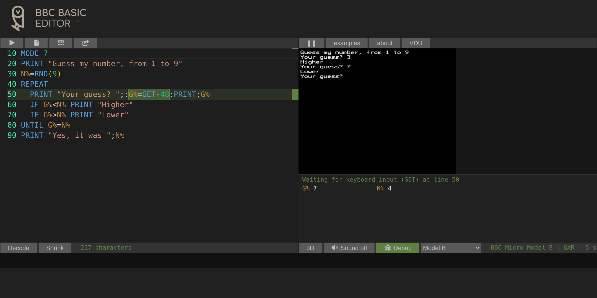

# Debug: watching BASIC run

This is the full description of Owlet's Debug panel: what each status means, how the errors that `ON ERROR` handlers
took are listed, and how Debug works them out from the emulated machine. The
[README](../README.md#debug-watching-basic-run) has the short version. For what red means in the editor's highlighting,
as opposed to the Debug panel's red mark, see [highlighting](highlighting.md).

The Debug button under the emulator opens a panel under the screen with BASIC's variables (the resident integers
`@%` and `A%` to `Z%` that the program has written to, then every other variable, then the names of the procedures
and functions it has found), and marks the statement BASIC is running in the editor: its line faintly, the
statement itself more strongly, and the line in the scroll bar. Both follow the program as it runs, many times a
second, and stay where they were while the emulator is paused, so pausing shows where the program had got to.

What is shown is read from the emulated machine's memory, with jsbeeb's reading of BASIC's workspace, and works the
same on the Model B (BASIC II) and the Master 128 (BASIC IV). The statement is the one BASIC's text pointer is in: a
line `IF A=1 THEN B=2:C=3 ELSE D=4` has the statements `IF A=1 THEN`, `B=2`, `C=3`, `ELSE` and `D=4`, a `REPEAT`,
`DEF PROC` or `ON ERROR` is a statement apart from the one after it, and `REM` and `DATA` run to the end of the line.
An abbreviation such as `P.` is marked as it is written. The panel says:

- **Running line N**: the program is running (or paused in) line N, which is marked in the editor.
- **Waiting for keyboard input (GET) at line N**: the program is waiting in line N for a key, for `GET`, `GET$`, or
  `INKEY` or `INKEY$` with a time limit, or for a line to be typed for `INPUT` or `INPUT LINE`; the brackets say which
  (for `PRINT GET;GET$`, which of the two), and are left out where it is not one of those, as for machine code that
  calls OSRDCH. A key pressed (and Return, for `INPUT`) takes it back to running. A program that reads the keyboard
  without waiting, as `INKEY(0)` and `INKEY(-n)` do, is running.
- **Waiting for vsync at line N**: the program is in `*FX19`, which waits for the next vertical sync, at most a
  fiftieth of a second. This is shown whenever the emulator's frame ends in the wait, so a program that waits for vsync
  shows it in turn with running, about as often as it waits.
- **Waiting for room in the sound queue at line N**: a `SOUND` whose channel already has its queue of notes waits for
  one to finish.
- **Waiting for the filing system at line N**: a `CHAIN`, `OPENIN`, `*CAT` or the like is waiting for the disc
  filing system. Owlet has no disc in the drive, so these wait for ever: Escape stops them on the Master 128,
  BREAK on either.
- **Running line N, which is not as in the editor**: the editor's line N is not what BASIC has, as after an edit
  since the program ran. Nothing is marked until the program runs again; the variables still update. Lines that were
  not edited are still marked, so an edit to one line does not lose the others.
- **No such variable (ERR 26) at line N**: the program stopped with that error in line N, which is marked in red:
  the statement the error was in, or the whole line where that is not known (see below). The variables are as the
  program left them, as they are on a real BBC Micro. This stays, through anything typed at the prompt, until the
  program runs again (from the run button, or a `RUN`, `GOTO` or `PROC` typed at the prompt; not a `LIST`), which is
  the point: the message is often not on the emulated screen, after `VDU 5` with the graphics cursor off the screen
  or in the background colour, or a `CLS`, or once a mistyped `REPORT` has replaced it.
- **STOP at line N** is shown the same way: the program stopped where it should not have gone on.
- **Escape (ERR 17) at line N** is shown the same way but in amber, as people press Escape on purpose.
- **..., which has changed since the error**: the editor's line N is not what BASIC ran, so nothing is marked.
- **Mistake (ERR 4) in a command typed at the prompt**: an error in a command typed at BASIC's prompt, shown only
  until the next command, and never in place of the error the program stopped with. BASIC gives such an error line
  0, as it does an error in a line numbered 0, so Debug tells them apart by whether a statement of the program had
  started since the last command was typed; switched on after the error, it takes line 0 to be the prompt.
- **At BASIC's prompt**: the program has ended, without an error, or not started; its variables stay as it left them.
- **Not BASIC**: another language ROM has taken over.

## Errors that ON ERROR handlers took

Under the status, the panel lists the errors that `ON ERROR` handlers took in this run, which are otherwise easy to
miss: once a handler runs, BASIC's own state no longer shows the error, and the handler may print nothing, or clear
the screen. The latest is first, each as `No such variable (ERR 26) at line 140, 3 times, taken by the ON ERROR at
line 20`, under the number taken in all. The last eight different errors are kept (an error is the same if it has the
same number, message, line, statement and handler, statements being told apart at colons, `THEN`, `ELSE`, `REPEAT`,
`IF` and the end of a `DEF`'s name and parameters, though not at an implicit `THEN` before anything but an `IF`, as in
`IF X Y=1`); a handler that loops on its own error, thousands of times a second, is one row with a growing count. The
latest one's statement is marked in the editor with a dashed box, which fades after about a second of the program
running on without another; the error the program stopped with, if it did, keeps its solid red mark and the status line,
and is not counted among the handled ones. Escape taken by a handler is listed in amber. The list starts afresh when the
program runs again, as the error the program stopped with does. The line is the one `ERL` gives, but found from BASIC's
text pointer as the error is raised, so an error in a line numbered 0 is at line 0, and one in a command typed at the
prompt has no line.

An error numbered 0 (`STOP`) never goes to an `ON ERROR` handler, so it is never listed: BASIC's own handler takes it.
Only plain `ON ERROR` exists in BASIC II and BASIC IV; `ON ERROR LOCAL` is BASIC V's, and on these machines sets a
handler that runs `LOCAL`, which fails with `Not LOCAL` and so loops forever, as the list then shows. Handled errors
are caught as they are raised, so only those raised while Debug is on are listed.

## How Debug tells waiting, running and stopped apart

A program is waiting when BASIC has not moved on to another statement for a whole frame of the emulator (a sixtieth of
a second or so) and the machine is in the OS's routine that reads the keyboard, in the filing system's ROM, or in a
`SOUND` statement; and in any frame that ends in `*FX19`'s wait, which is never longer than a frame. jsbeeb works out
which of these the machine is in. Anything else that holds a program up, such as a long `PRINT`, or machine code that
waits in a loop of its own, is shown as running. The waiting line and statement are marked as the running ones are, and
`..., which is not as in the editor` is added in the same way.

A program has stopped with an error when BASIC's own error handler, which is BASIC text in its ROM, is the last text it read; the
number and message are those `ERR` and `REPORT` give, and the line is `ERL`. BASIC keeps no note of where in the line
the error was: its error handler moves its text pointer to the `ON ERROR` text. So the statement is known only when
Debug was on as the error was raised, and caught the pointer then; switched on later, Debug marks the whole line. An
error inside an `EVAL` marks the statement the `EVAL` is in, as `X=EVAL("x")` in `IF 1 THEN X=EVAL("x")`. BASIC raises
an error in a `PROC`'s or `FN`'s arguments, inside an `EVAL` or not, at its `DEF`, so that is what is marked: the `DEF`'s
name and parameters, in the line `ERL` gives.

## Resident integers

A resident integer is shown once the program has written to it, even if it wrote the value BASIC starts it with, so
after `X%=1:X%=0` the panel shows `X%` as `0`. Running the program again starts afresh, with nothing written. Debug
notes the writes from the moment it is switched on, so what the program wrote earlier is not known: for those, a
resident integer is shown only if it is not as BASIC starts it (`@%` other than `&90A`, `A%` to `Z%` other than 0).
Switch Debug on before running the program (the run button runs it again) to see them all.

## What Debug costs

While Debug is off nothing is read from the machine and nothing is hooked, so it costs nothing. While it is on, the
emulator notes writes to the resident integers, where BASIC was and which handler was set when the OS takes an error,
and when a statement of the program starts or BASIC moves on, through jsbeeb's write hook, which makes it do a little
more work on each write the program makes. Debug is not remembered between visits.
