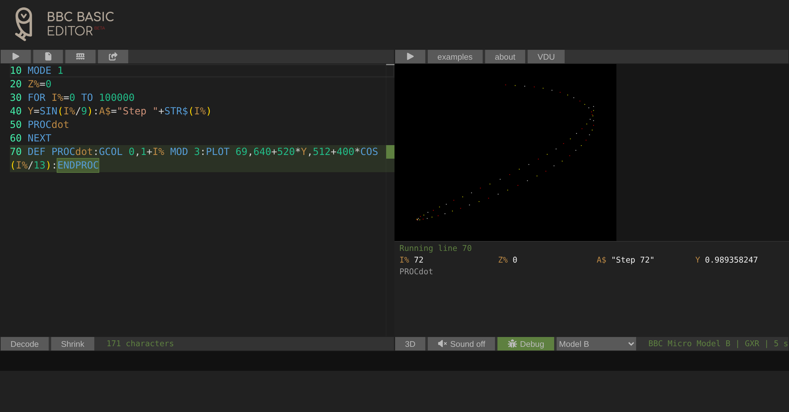
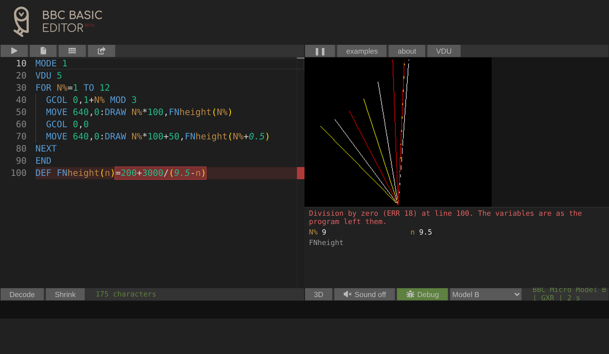
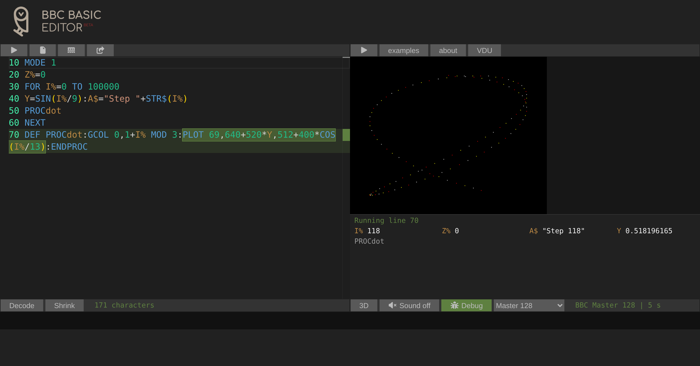
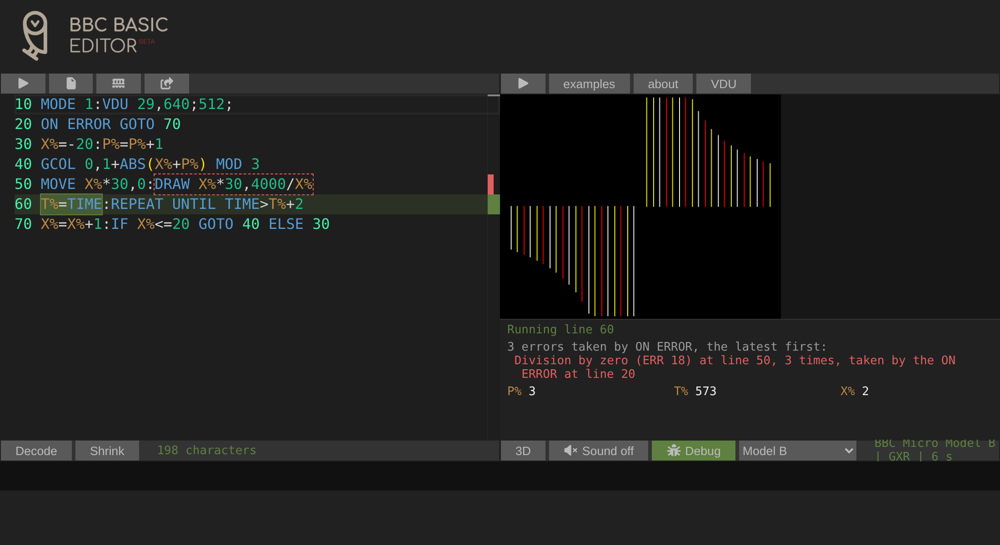
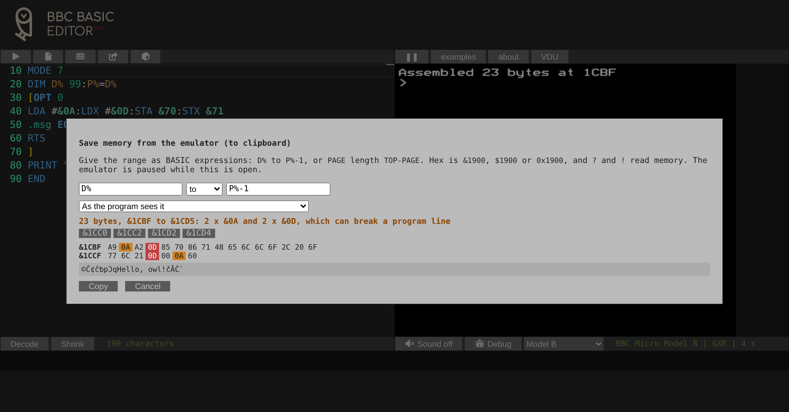

# Debug: watching BASIC run

Owlet's Debug panel in full: what each status means, how the errors that `ON ERROR` handlers took are listed, and how
Debug works them out from the emulated machine; and the Save memory dialog, which copies bytes from the machine.
The [README](../README.md#debug-watching-basic-run) has the short version; for red in the editor's highlighting, as
opposed to the Debug panel's red mark, see [highlighting](highlighting.md).

The Debug button under the emulator opens a panel under the screen with BASIC's variables (the resident integers
`@%` and `A%` to `Z%` that the program has written to, then every other variable, then the names of the procedures
and functions it has found), and marks the statement BASIC is running in the editor: its line faintly, the
statement itself more strongly, and the line in the scroll bar. Both follow the program as it runs, many times a
second, and stay put while the emulator is paused, so pausing shows where the program had got to.

Everything is read from the emulated machine's memory, using jsbeeb's reading of BASIC's workspace, the same way on
the Model B (BASIC II) and the Master 128 (BASIC IV). The statement is the one BASIC's text pointer is in: a
line `IF A=1 THEN B=2:C=3 ELSE D=4` has the statements `IF A=1 THEN`, `B=2`, `C=3`, `ELSE` and `D=4`, a `REPEAT`,
`DEF PROC` or `ON ERROR` is a statement apart from the one after it, and `REM` and `DATA` run to the end of the line.
An abbreviation such as `P.` is marked as it is written. The panel says:

- **Running line N**: the program is running (or paused in) line N, which is marked in the editor.
- **Waiting for keyboard input (GET) at line N**: the program is waiting in line N for a key (`GET`, `GET$`, or
  `INKEY` or `INKEY$` with a time limit) or a typed line (`INPUT` or `INPUT LINE`); the brackets say which (for
  `PRINT GET;GET$`, which of the two), and are left out for anything else, such as machine code that calls OSRDCH. A
  key (and Return, for `INPUT`) takes it back to running. A program that reads the keyboard without waiting, as
  `INKEY(0)` and `INKEY(-n)` do, is running.
- **Waiting for vsync at line N**: the program is in `*FX19`, which waits for the next vertical sync, at most a
  fiftieth of a second. It is shown whenever an emulator frame ends in the wait, so a program that waits for vsync
  alternates between this and running, about as often as it waits.
- **Waiting for room in the sound queue at line N**: a `SOUND` whose channel already has its queue of notes waits for
  one to finish.
- **Waiting for the filing system at line N**: a `CHAIN`, `OPENIN`, `*CAT` or the like is waiting for the disc
  filing system. Owlet has no disc in the drive, so these wait for ever: Escape stops them on the Master 128,
  BREAK on either.
- **Running line N, which is not as in the editor**: the editor's line N is not what BASIC has, as after an edit
  since the program ran. Nothing is marked until the program runs again, though the variables still update; unedited
  lines are still marked, so an edit to one line does not lose the others.
- **No such variable (ERR 26) at line N**: the program stopped with that error in line N, which is marked in red:
  the statement the error was in, or the whole line where that is not known (see below). The variables are as the
  program left them, as on a real BBC Micro. This stays through anything typed at the prompt until the program runs
  again (the run button, or a `RUN`, `GOTO` or `PROC` at the prompt; not a `LIST`), because the message is often not on
  the emulated screen: after `VDU 5` with the graphics cursor off the screen or in the background colour, after a
  `CLS`, or once a mistyped `REPORT` has replaced it.
- **STOP at line N** is shown the same way: the program stopped where it should not have gone on.
- **Escape (ERR 17) at line N** is shown the same way but in amber, as people press Escape on purpose.
- **..., which has changed since the error**: the editor's line N is not what BASIC ran, so nothing is marked.
- **Mistake (ERR 4) in a command typed at the prompt**: an error in a command typed at BASIC's prompt, shown only
  until the next command, and never in place of the error the program stopped with. BASIC gives such an error line
  0, as it does an error in a line numbered 0, so Debug tells them apart by whether a statement of the program had
  started since the last command; switched on after the error, it takes line 0 to be the prompt.
- **At BASIC's prompt**: the program has ended, without an error, or not started; its variables stay as it left them.
- **Not BASIC**: another language ROM has taken over.

## Errors that ON ERROR handlers took

Under the status, the panel lists the errors that `ON ERROR` handlers took in this run, which are otherwise easy to
miss: once a handler runs, BASIC's own state no longer shows the error, and the handler may print nothing, or clear
the screen. The latest is first, each as `No such variable (ERR 26) at line 140, 3 times, taken by the ON ERROR at
line 20`, under the number taken in all. The last eight different errors are kept (an error is the same if it has the
same number, message, line, statement and handler, statements being told apart at colons, `THEN`, `ELSE`, `REPEAT`,
`IF` and the end of a `DEF`'s name and parameters, though not at an implicit `THEN` before anything but an `IF`, as in
`IF X Y=1`); a handler that loops on its own error, thousands of times a second, is one row with a growing count. The
latest one's statement is marked in the editor with a dashed box, which fades after about a second of the program
running on without another; the error the program stopped with, if any, keeps its solid red mark and the status
line, and is not counted among the handled ones. Escape taken by a handler is listed in amber. The list starts afresh
when the program runs again. The line is the one `ERL` gives, but found from BASIC's text pointer as the error is
raised, so an error in a line numbered 0 is at line 0, and one in a command typed at the prompt has no line.

An error numbered 0 (`STOP`) never goes to an `ON ERROR` handler, so it is never listed: BASIC's own handler takes it.
Only plain `ON ERROR` exists in BASIC II and BASIC IV; `ON ERROR LOCAL` is BASIC V's, and on these machines sets a
handler that runs `LOCAL`, which fails with `Not LOCAL` and so loops forever, as the list then shows. Handled errors
are caught as they are raised, so only those raised while Debug is on are listed.

## How Debug tells waiting, running and stopped apart

A program is waiting when BASIC has not moved on to another statement for a whole frame of the emulator (a sixtieth of
a second or so) and the machine is in the OS's routine that reads the keyboard, in the filing system's ROM, or in a
`SOUND` statement; and in any frame that ends in `*FX19`'s wait, which is never longer than a frame. jsbeeb works out
which of these the machine is in. Anything else that holds a program up, such as a long `PRINT`, or machine code that
waits in a loop of its own, is shown as running. The waiting line and statement are marked as the running ones are, and
`..., which is not as in the editor` is added in the same way.

A program has stopped with an error when the last text BASIC read is its own error handler (BASIC text in its ROM);
the number and message are those `ERR` and `REPORT` give, and the line is `ERL`. BASIC keeps no note of where in the
line the error was, as its error handler moves the text pointer to the `ON ERROR` text, so the statement is known only
if Debug was on to catch the pointer as the error was raised; switched on later, Debug marks the whole line. An error
inside an `EVAL` marks the statement the `EVAL` is in, as `X=EVAL("x")` in `IF 1 THEN X=EVAL("x")`. BASIC raises an
error in a `PROC`'s or `FN`'s arguments, inside an `EVAL` or not, at its `DEF`, so that is what is marked: the `DEF`'s
name and parameters, in the line `ERL` gives.

## Resident integers

A resident integer is shown once the program has written to it, even if it wrote the value BASIC starts it with, so
after `X%=1:X%=0` the panel shows `X%` as `0`. Running the program again starts afresh, with nothing written. Debug
notes writes only while it is on; for earlier ones, a resident integer is shown only if it is not as BASIC starts it
(`@%` other than `&90A`, `A%` to `Z%` other than 0).
Switch Debug on before running the program (the run button runs it again) to see them all.

## What Debug costs

While Debug is off nothing is read from the machine and nothing is hooked, so it costs nothing. While it is on, the
emulator notes, through jsbeeb's write hook, writes to the resident integers, where BASIC was and which handler was set
when the OS takes an error, and when a statement of the program starts or BASIC moves on; that adds a little work to
each write the program makes. Debug is not remembered between visits.

## Save memory: copying bytes into a program

The Save memory button (the memory chip in the editor's toolbar) copies a range of the emulated machine's memory to the
clipboard as text that can go in a program line, such as machine code or a data table to keep in a `REM` or a string.
Each byte is the character BBC BASIC shows it as, with a control code (0 to 31) and 127 to 160 as the character 256
higher (&0A is U+010A), which is how Owlet takes such bytes in program text. It works whether or not Debug is on, and
the emulator is paused while the dialog is open, so the bytes it shows are the bytes it copies; it carries on when the
dialog closes, if it was running before.

The range is a start and either an end (`to`, the last byte copied) or a length, each a BASIC numeric expression
worked out as BBC BASIC would, from the machine's memory as the program left it:

- numbers, in decimal or hex: `&1900`, and also `$1900` and `0x1900`;
- the program's numeric variables, including labels set by the assembler (`D%`, `buf`, `msg`), the resident integers
  `A%` to `Z%` (0 until set, as in BASIC), and `PAGE`, `TOP`, `HIMEM` and `LOMEM`;
- `+`, `-`, `*`, `/`, `DIV`, `MOD`, `AND`, `OR` and `EOR` at BASIC's precedences, brackets and unary minus;
- indirection: `?A` is the byte at `A`, `!A` the four bytes there, and `A?3` and `A!3` those at `A+3`, so
  `!&70 AND &FFFF` follows a pointer in zero page.

So after `DIM D% 99:P%=D%:[...]`, `D%` to `P%-1`, or `D%` length `P%-D%`, is what was assembled. The result is
truncated to a whole number, and the range must lie in &0000 to &FFFF: one that runs past &FFFF is refused rather
than wrapped round to &0000. A mistake is shown in place of the bytes, as BASIC would say it (`Start: No such
variable: Q`), and Copy waits until there is none. It opens on the BASIC program (`PAGE` length `TOP-PAGE`) and then
keeps the range last given, so after changing and running the program again, the same range is a click away. Return
in either box copies and Escape closes.

Under the range the dialog says how many bytes it covers and how many of them are &0A or &0D, which can break a program
line, with a button for each of the first twelve that brings it into view. The bytes, up to the first 4096, are shown
in hex, 16 to a row (8 on a phone held upright), with &0A in orange and &0D in red, and under them the start of the
text that will be copied.

### Which memory

The menu under the range chooses what is read. **As the program sees it** is the memory a BASIC program reads with `?`
and `!`, and what the dialog has always copied. The other choices show what is not paged in:

- **Bank N (...)**: a sideways bank at &8000 to &BFFF, named by the ROM in it, such as BASIC or the DFS; banks with
  nothing in them are left out.
- On the Master 128 only, as the Model B has no shadow RAM: **ANDY** (&8000 to &8FFF), **Main RAM** and **Shadow
  RAM** (both &3000 to &7FFF). In a shadow screen mode such as `MODE 135` the screen is in shadow RAM, while the
  program reads and writes main RAM at the same addresses, so the dialog says so when the range covers the screen and
  Shadow RAM is not chosen.

Outside the addresses a choice covers, it reads as the program sees memory. Nothing is read with side effects: a
hardware register that cannot be read without changing it (in &FC00 to &FEFF) reads as &FF.
